<picture>
  <source media="(prefers-color-scheme: dark)" srcset="assets/banner-dark.svg">
  
</picture>

  
  
  
  
  

I'm a data analyst in Melbourne, part way through a Master of Data Science at Swinburne University of Technology. Before that I spent close to four years in India on product and market insights: the SQL pulls, Tableau dashboards, A/B test reports and weekly KPI roll-ups that product and marketing managers relied on.

The work I enjoy most is the unglamorous part. Ask what decision a number is for. Agree the definition before building anything. Keep the workings reproducible, so a report rerun six months later gives the same answer.

**Open to** graduate and junior data analyst roles in Melbourne · full working rights in Australia

## Selected work

<table>
<tr>
<td width="50%" valign="top">

### [OSHC When It Matters](https://github.com/Bikram2051/oshc-when-it-matters)
TEAM PROJECT · SWINBURNE · INDUSTRY PARTNER: MEDIBANK

A learning prototype with a guardrailed chat that helps international students make sense of their health cover.

**The hard part.** Every answer it releases passes an input review, grounded generation and an output audit, with citations checked against the source PDF. The evaluation is designed around held-out probes the builders never see.

**My part.** Bill extraction, benefit and MBS arithmetic written test-first, the classifier and the evaluation code.

`Python` `Streamlit` `Claude Haiku` `pytest`

</td>
<td width="50%" valign="top">

### [Survey Platform](https://github.com/Bikram2051/survey-platform)
BACKEND MVP · SURVEY STATISTICS · NEPAL MARKET

A multi-tenant backend for survey and field data collection, built so that estimates admit their uncertainty.

**The hard part.** Tenant isolation is enforced by Postgres row-level security and proven by tests. Offline sync is append-only with idempotency keys. Raking to census margins reports Kish effective sample sizes, so no percentage leaves the API without its standard error.

`Django REST` `PostgreSQL` `Docker` `pytest`

</td>
</tr>
</table>

<table>
<tr>
<td width="50%" valign="top">

### [Domain-adaptive sentiment analysis](https://github.com/TDP-2026-Repository/TECHNOLOGY-DESIGN-PROJECT)
TEAM PROJECT · SWINBURNE · MY ROLE: DATA ENGINEER

One sentiment model that has to read both casual Reddit comments and formal financial reporting.

**The hard part.** I owned the data side: a single preprocessing pipeline and frozen train, validation and test splits across GoEmotions and the Financial PhraseBank, so no modelling notebook could leak data into its own evaluation.

`pandas` `Hugging Face` `BERT / FinBERT` `Streamlit`

</td>
<td width="50%" valign="top">

### [Bank loan portfolio dashboard](https://public.tableau.com/app/profile/bikram.bhattarai/viz/BANKLOANDASHBOARD_17339885232100/Summary)
PERSONAL PROJECT · SQL SERVER TO TABLEAU

Headline lending KPIs for a loan book, across three linked dashboards.

**The hard part.** Month-on-month movement built with CTEs and window functions, loans split into performing and non-performing, and every figure on the dashboards reconciled back to the SQL.

`SQL Server` `Tableau`

</td>
</tr>
</table>

<b>More work</b>

 

| Project | What it shows |
|:--|:--|
| [AlVik](https://github.com/Bikram2051/AlVik) | A single-file AI chat client behind its own Cloudflare Worker: signed sessions, cross-device sync, and CI that fails the build if a key reappears in the client. `JavaScript` |
| [Company bankruptcy prediction](https://bikram2051.github.io/projects.html) | 64 financial ratios and very few failures. SMOTE and cost-sensitive learning, judged on recall and ROC AUC rather than accuracy. `scikit-learn` |
| [EV population analysis](https://public.tableau.com/app/profile/bikram.bhattarai/viz/ElectricVehicleDataAnalysis_17315002218810/Dashboard1) | Washington State EV registrations, explained for a non-technical audience. `Python` `Tableau` |
| [EchoSphere](https://github.com/Bikram2051/university-web-app-php-java) | A full-stack PHP and MySQL store with server-side validation and an order dashboard. `PHP` `MySQL` |

## Toolkit

Everything here I have used on a project, not just read about.

<table>
<tr><td><b>Query</b></td><td>SQL (SQL Server, PostgreSQL): joins, CTEs, window functions</td></tr>
<tr><td><b>Program</b></td><td>Python (pandas, NumPy, scikit-learn, matplotlib, seaborn) · R</td></tr>
<tr><td><b>Report</b></td><td>Tableau · Power BI · Looker Studio · Excel</td></tr>
<tr><td><b>Analyse</b></td><td>A/B testing · regression · clustering · forecasting · cohort and retention · survey weighting</td></tr>
<tr><td><b>Build</b></td><td>Streamlit · Django REST · Cloudflare Workers · Docker · Git and GitHub Actions</td></tr>
</table>

## Now

- Building **OSHC When It Matters** with Team D5 for COS70008, with Medibank as industry partner
- Studying machine learning, NLP and transformers, and big data processing
- Finishing the Master of Data Science in 2027

 

Thanks for reading,

<picture>
  <source media="(prefers-color-scheme: dark)" srcset="assets/signature-dark.svg">
  
</picture>
