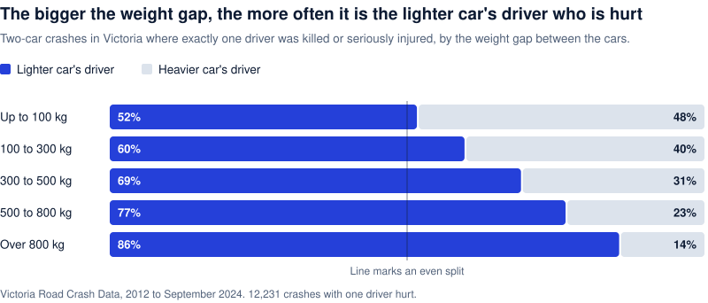

# Bikram Bhattarai

Data analyst in Melbourne. Close to four years in product and market insights, now finishing a Master of Data Science at Swinburne University of Technology. Day to day I work in SQL, Python, R, Tableau and Power BI.

I ask what a number is for before I calculate it, agree the definition before building anything, and keep the workings reproducible.

**[Portfolio](https://bikram2051.github.io)** &nbsp;|&nbsp; [Articles](https://bikram2051.github.io/articles/) &nbsp;|&nbsp; [LinkedIn](https://www.linkedin.com/in/bikram2051/) &nbsp;|&nbsp; [Tableau Public](https://public.tableau.com/app/profile/bikram.bhattarai/vizzes) &nbsp;|&nbsp; [Resume (PDF)](https://bikram2051.github.io/assets/Bikram-Bhattarai-Resume.pdf) &nbsp;|&nbsp; [Email](mailto:vikrambhattarai1994@gmail.com)

Open to graduate and junior data analyst roles in Melbourne. Australian permanent resident with full working rights.

## Latest: vehicle weight and driver injury in two-car crashes

<a href="https://bikram2051.github.io/projects/crash-weight/">
  <picture>
    <source media="(prefers-color-scheme: dark)" srcset="assets/crash-weight-dark.svg">
    
  </picture>
</a>

A matched-pair study of 57,217 crashes in Victoria, done in R with a teammate for a big data unit at Swinburne. We compared the two drivers inside each crash with conditional logistic regression, so the road, the weather and the speed limit cancel out.

After adjusting for driver age and sex, vehicle age, seatbelt use and point of impact, each 10% of extra weight went with about 20% lower odds of that car's driver being killed or seriously injured (odds ratio 0.796, 95% CI 0.784 to 0.808). The planned straight-line model did not hold up when tested, so the final model works on the ratio of the two weights.

My part was the data build, the models and the figures. **[Read the case study](https://bikram2051.github.io/projects/crash-weight/)**

`R` `survival` `dplyr` `ggplot2`

## Other work

| Project | What it is | Built with |
|:--|:--|:--|
| [OSHC When It Matters](https://github.com/Bikram2051/oshc-when-it-matters) | A learning prototype that helps international students understand their Overseas Student Health Cover. Every chat answer passes an input review, a grounded draft and an output audit. I wrote the benefit arithmetic, the question classifier and the evaluation harness, all test first. Industry partner: Medibank. | Python, Streamlit, pytest |
| [Domain adaptive sentiment analysis](https://github.com/TDP-2026-Repository/TECHNOLOGY-DESIGN-PROJECT) | As the team's data engineer I built one preprocessing pipeline and fixed train, validation and test splits across GoEmotions and the Financial PhraseBank, so no modelling notebook could leak data into its own evaluation. | Python, pandas, Hugging Face |
| [Australian beach and water locations](https://github.com/Bikram2051/Bikram2051-COS60008-Assignment) | Open data on beach amenities and regional climate, cleaned and analysed in a notebook that can be rerun end to end. | Python, pandas, Jupyter |
| [EchoSphere](https://github.com/Bikram2051/university-web-app-php-java) | A full-stack PHP and MySQL store with server-side validation and an order dashboard. | PHP, MySQL |

Dashboards are on [Tableau Public](https://public.tableau.com/app/profile/bikram.bhattarai/vizzes). The [portfolio](https://bikram2051.github.io/projects/) has the full write-ups.

## Toolkit

| | |
|:--|:--|
| Querying | SQL (MS SQL Server, PostgreSQL), CTEs, window functions |
| Programming | Python (pandas, NumPy, scikit-learn), R |
| Statistics | Regression, A/B testing, cohort and retention analysis, survey weighting |
| Reporting | Tableau, Power BI, Looker Studio, Excel |
| Building | Streamlit, Django REST, Docker, GitHub Actions |
